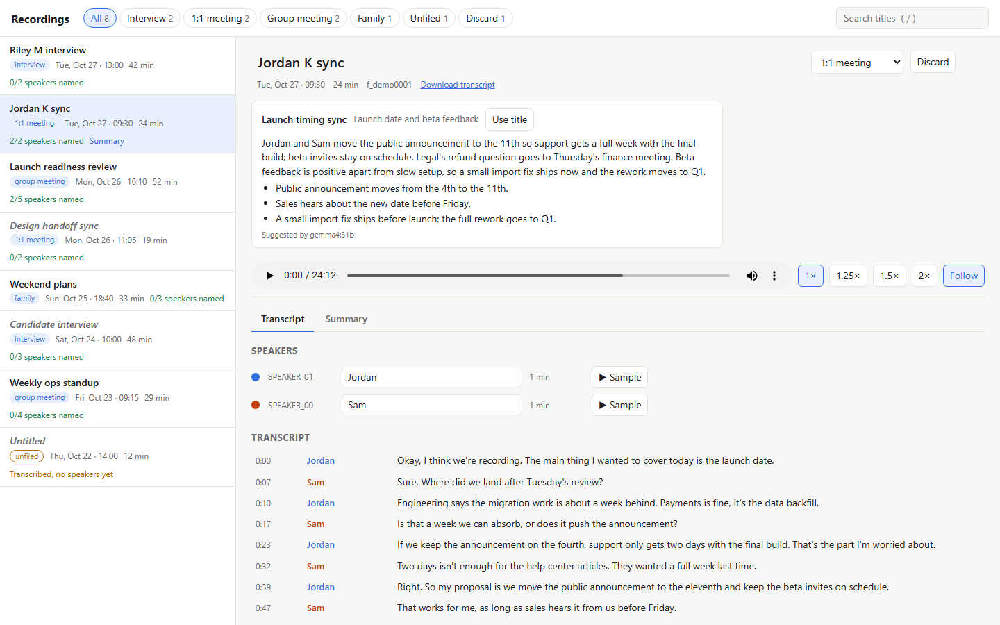
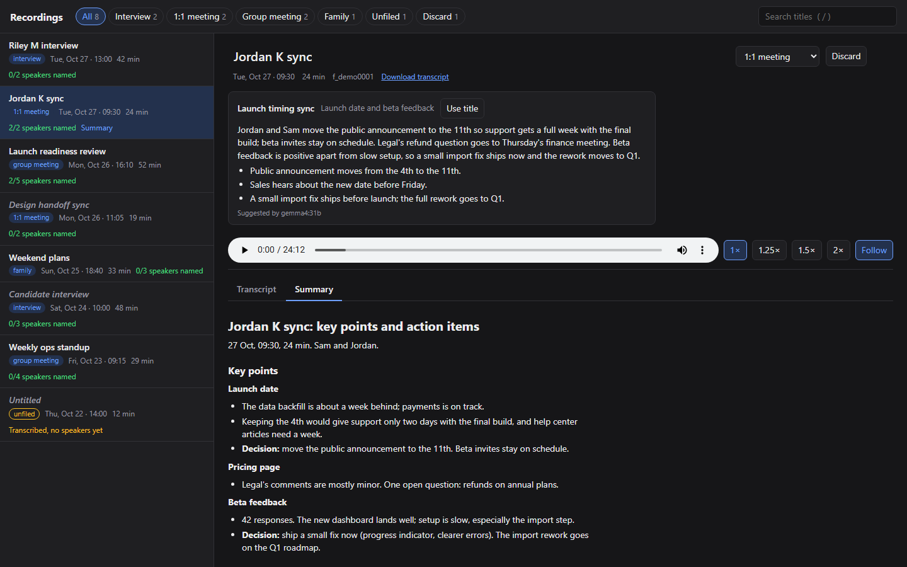

# earshot

Local-first pipeline for recorder audio: syncs Plaud recordings, transcribes and labels speakers
offline, triages each with a local LLM, and gives you a page to listen, title and file them.

**Status:** a personal project, early and opinionated. It runs every day on one machine
(Windows 11 + WSL2, an NVIDIA RTX 4080 and a Plaud Note), so expect rough edges and hard
requirements. The design notes are in [SPEC.md](SPEC.md).



## What it does

- **Syncs** new recordings from your Plaud account once a day, using Plaud's official CLI login.
  Each download is checked: the byte count matches, it decodes cleanly, and its length agrees
  with what Plaud reports. Any recording still without a transcript is retried on the next run.
- **Transcribes and labels speakers offline.** It uses faster-whisper large-v3 and pyannote
  `speaker-diarization-community-1`. Both run inside a network namespace with no network access.
- **Writes a triage brief with a local LLM** (Ollama, `gemma4:31b` by default):
  - a category (interview, 1:1 meeting, group meeting or family), which files the recording
  - a topic and a suggested title
  - a summary of up to 60 words and a few takeaways

  The brief tells you whether a recording deserves a full summary at all.
- **Drafts full summaries on request** with a local LLM (`qwen3.8:27b-128k`, reasoning on, by
  default). There's a template per category: interview, 1:1 and group meeting. Every point
  cites the time in the transcript it came from. Interview notes record evidence, never a
  verdict.
- **Review page** at http://localhost:8790:
  - listen with the transcript beside the player, and click a line to jump there
  - an inbox of the recordings you haven't dealt with yet; archive each one when you're done
  - rename and recategorize recordings
  - name speakers; giving two labels the same name merges them
  - discard recordings
  - read summaries
- **Backs up** hourly to a NAS. Original audio is append-only and checksum-verified.
- **Alerts on Slack** when:
  - the Plaud login is about to lapse
  - a step fails
  - new recordings are ready

  Once a week it also lists recordings that are safe to delete from Plaud's cloud.

## Privacy model

- **Audio and transcripts stay on your machines.** Transcription and speaker labelling have no
  network access, and briefs go only to an Ollama server you run. Ollama's `-cloud` models are
  refused.
- **Slack messages carry dates and durations only**, never titles or transcript text.
- **The review page listens on 127.0.0.1 by default.** It rejects unexpected `Host` headers
  (which blocks DNS rebinding) and cross-site writes. Remote access is opt-in: it's limited to
  networks you name and needs a token ([Remote access](#remote-access-eg-wireguard)).
- **Plaud's cloud keeps its own copy** until you delete it in the Plaud app. earshot tells you
  when that's safe.

## How it works

```
Plaud cloud ──> sync.py ──> ~/recordings/plaud/audio/        (originals, never modified)
   (17:00)        │
                  ├─> transcribe (faster-whisper, no network)
                  ├─> diarize    (pyannote, no network)  ──> ~/recordings/plaud/transcripts/
                  ├─> brief.py   (local Ollama)          ──> <stem>.brief.json + category
                  └─> Slack: "N new recordings, triage them at localhost:8790"

review/server.py (systemd, :8790) ── inbox, listen, title, recategorize, name speakers, archive, discard
backup.sh (hourly) ──> NAS: originals append-only + verified; metadata mirrored, never deleted
```

`folders.csv` in `~/recordings` is the filing record: id, start time, duration, category and
title. It's plain CSV, so you can edit it by hand.

## Requirements

- **Linux or WSL2**, with systemd user services and cron
- **Python 3.11+.** earshot itself uses only the standard library.
- **Tools:** `ffmpeg`, `rsync`, and `unshare` / `flock` (util-linux)
- **An NVIDIA GPU** with about 6 GB of free VRAM for transcription and speaker labelling
- **A Plaud account** and Plaud's official CLI (`@plaud-ai/cli`)
- **[pyarize](https://github.com/michaelv2/pyarize):** earshot currently runs its download,
  transcription and speaker-labelling scripts, and uses its pyannote environment. Moving the
  download step into earshot is planned.
  - **Tested with pyarize at
    [`b421e7f`](https://github.com/michaelv2/pyarize/commit/b421e7f)** (2026-10-30). Earlier
    versions don't decode-check downloads.
  - earshot calls the scripts by path, so later versions work as long as their command lines
    and output files stay the same.
- **A Python environment with `faster-whisper`**
- **A Hugging Face token**, needed once to download the gated pyannote model
- **Optional:**
  - Ollama with a local model, for briefs. The sync carries on without it.
  - A Slack incoming webhook
  - A mounted NAS share, for backups

## Setup

1. **Clone** earshot and pyarize side by side, e.g. into `~/projects/`.
2. **Install the Plaud CLI** into its own prefix, pinned, without install scripts:
   ```bash
   npm --prefix ~/.local/plaud-cli install --ignore-scripts @plaud-ai/cli@0.3.14
   ```
   Then add a wrapper at `~/.local/bin/plaud`. It turns the CLI's telemetry off, and stops a
   `.env` file in the current folder from redirecting its login endpoints:
   ```bash
   #!/usr/bin/env bash
   export PLAUD_TELEMETRY_DISABLED=1 DO_NOT_TRACK=1 PLAUD_NO_UPDATE_NOTIFIER=1
   export DOTENV_CONFIG_PATH=/dev/null DOTENV_CONFIG_QUIET=true
   exec "$HOME/.local/plaud-cli/node_modules/.bin/plaud" "$@"
   ```
   Make it executable and run `plaud login` once. After that, refresh tokens rotate on each use,
   so a daily sync keeps the login alive.
3. **Set up pyarize** (see its `scripts/README.md`). That covers its pyannote environment, the
   one-time model download with your Hugging Face token, and a Python environment with
   faster-whisper.
4. **Write your machine's settings** to `~/.config/earshot/env` (mode 600). See Configuration
   below.
5. **Optionally, set up Slack.** Export `SLACK_WEBHOOK_URL` in `~/.bashrc_env`, which the cron
   scripts source.
6. **Schedule the sync and backup** with `crontab -e`:
   ```
   0 17 * * * ~/projects/earshot/sync_cron.sh
   45 * * * * ~/projects/earshot/backup.sh
   ```
7. **Install the review page** as a systemd user service. Run
   `loginctl enable-linger $USER` once if you want it running without a login session.
   ```bash
   ln -s ~/projects/earshot/deploy/earshot-review.service ~/.config/systemd/user/
   systemctl --user daemon-reload && systemctl --user enable --now earshot-review
   ```
8. **Check it all:** `~/projects/earshot/sync_cron.sh --dry-run`, then read
   `~/.local/share/earshot/sync.log`. The log starts with a preflight check. It either says
   `preflight ok`, or names what's missing and which setting to change:
   - the pyarize folder or its environment
   - the pyannote model download
   - a Python that can import faster-whisper
   - the Plaud CLI wrapper

## Configuration

`~/.config/earshot/env` holds plain `KEY=value` lines, loaded by `sync_cron.sh`, `backup.sh` and the
review page's systemd unit:

| Variable | Default | What it's for |
|---|---|---|
| `EARSHOT_PYARIZE_DIR` | `~/projects/pyarize` | pyarize checkout (download, transcription and speaker-labelling scripts) |
| `EARSHOT_WHISPER_PYTHON` | `python3` | A Python with `faster-whisper` installed |
| `EARSHOT_OLLAMA_URL` | `$OLLAMA_HOST`, then `localhost:11434` | Ollama server for briefs |
| `EARSHOT_BRIEF_MODEL` | `gemma4:31b` | Brief model; must be a local model |
| `EARSHOT_SUMMARY_MODEL` | `qwen3.8:27b-128k` | Full-summary model; must be a local model |
| `EARSHOT_OWNER` | `Michael` | Your name, as the summary templates refer to you |
| `EARSHOT_BACKUP_MOUNT` | `/mnt/s` | Backups are skipped, with an alert, if this isn't mounted |
| `EARSHOT_BACKUP_DIR` | `$EARSHOT_BACKUP_MOUNT/backup/recordings` | Backup destination |
| `EARSHOT_REVIEW_BIND` | `127.0.0.1` | Review page listen address; see [Remote access](#remote-access-eg-wireguard) |
| `EARSHOT_REVIEW_HOSTS` | none | Comma-separated `host:port` names you browse to from other devices |
| `EARSHOT_REVIEW_ALLOW_FROM` | none | Comma-separated networks allowed besides loopback; `gateway` means the default gateway |
| `EARSHOT_REVIEW_TOKEN` | none | Sign-in token for remote devices, 20+ characters; required with `ALLOW_FROM` |

For example:
```
EARSHOT_OLLAMA_URL=http://192.168.1.50:11434
EARSHOT_WHISPER_PYTHON=/home/you/venvs/whisper/bin/python
```

## Using it

Open http://localhost:8790. On WSL2, the Windows browser reaches it at the same address.

### Remote access (e.g. WireGuard)

Off by default. To reach the page from a phone over a VPN that ends on your router:

1. Add to `~/.config/earshot/env`, then `systemctl --user restart earshot-review`:
   ```
   EARSHOT_REVIEW_BIND=0.0.0.0
   EARSHOT_REVIEW_HOSTS=192.168.1.20:8790   # this machine's LAN address, as you'll type it
   EARSHOT_REVIEW_ALLOW_FROM=gateway        # WSL2; on plain Linux, your VPN subnet instead
   EARSHOT_REVIEW_TOKEN=...                 # python3 -c "import secrets; print(secrets.token_urlsafe(16))"
   ```
2. On WSL2, Windows has to forward the port, and every forwarded connection reaches WSL from the
   default gateway (hence `gateway`). So the Windows firewall decides who gets in: allow the
   port from your VPN subnet only. In an admin PowerShell:
   ```powershell
   $ip = (wsl hostname -I).Trim().Split(" ")[0]
   netsh interface portproxy add v4tov4 listenport=8790 listenaddress=0.0.0.0 connectport=8790 connectaddress=$ip
   New-NetFirewallRule -DisplayName "earshot review (VPN)" -Direction Inbound -Protocol TCP -LocalPort 8790 -RemoteAddress <vpn-subnet> -Action Allow
   ```
   WSL's address changes on reboot, so refresh the portproxy at logon (Task Scheduler).
3. On the router, allow VPN clients to reach this machine on port 8790, and include its address
   in the client's `AllowedIPs`.
4. Print the sign-in link in your own terminal, and open it once on each device:
   `(set -a; . ~/.config/earshot/env; python3 -I review/server.py --link)`. It sets a year-long
   cookie (HttpOnly, SameSite=Strict) and drops the token from the address bar. Changing the token
   signs every device out. Refused requests are logged, without paths or tokens:
   `journalctl --user -u earshot-review`.

Traffic is plain HTTP between the router and this machine; the VPN encrypts the rest.

- **Triage.** Each new recording shows its brief above the player. Fix the category if it's
  wrong, press **Use title** or type your own title and press Enter, and name the speakers.
  `▶ Sample` plays a speaker's longest stretch, to tell who's who.
- **Inbox.** The page opens on the Inbox: every recording you haven't archived or discarded,
  newest first. Once you've dealt with one, for example by copying what matters into memoize,
  press **Archive** (`A`), or hover over its row in the list and press the row's **Archive**
  button. Archived recordings stay under All and their category, marked "Archived". **Unarchive**
  (`A` again) puts one back. The date you archived it is stored in the `archived` column of
  `folders.csv`, and blank means it's still in the inbox.
- **Discard** (`D`) hides a recording and marks it as not worth a summary. The audio is kept,
  and **Restore** brings it back.
- **Summaries.** Run `python3 -I summarize.py <id>` to draft one; it appears on the Summary tab.
  - **Name the speakers first,** including yourself, or action items can't have owners.
  - **It takes 3–6 minutes** for an hour-long recording.
  - **Check before you keep anything.** Every bullet ends with the `[mm:ss]` it came from.
  - **Regenerating** keeps the previous draft as `<stem>.summary.prev.md`.
  - **Templates** are in `templates/`. To change one privately, copy it to
    `~/.config/earshot/templates/` and edit the copy.

  
- **Keys:**

  | Key | Action |
  |---|---|
  | `Space` | Play / pause |
  | `←` `→` | Back / forward 5 s (`Shift` for 30 s) |
  | `N` | Next untitled recording |
  | `T` | Edit the title |
  | `A` | Archive / unarchive |
  | `D` | Discard / restore |
  | `/` | Search |

**Try it without a Plaud.** `demo/make_demo.py` builds a fake library. Everything in it is invented:
the people, the conversations, and the audio, which is silence. The screenshots above come from it.
```bash
python3 -I demo/make_demo.py /tmp/earshot-demo
python3 -I review/server.py --root /tmp/earshot-demo/recordings --port 8791   # http://localhost:8791
```
Add `#<id>` to the page address to open a recording directly, and `#<id>/summary` to open it on
the Summary tab.

Command line:
```bash
./sync_cron.sh --dry-run                 # check the login and list new recordings, change nothing
./sync_cron.sh --safe-to-delete          # list Plaud cloud recordings with a verified NAS copy
python3 -I brief.py --missing            # brief everything transcribed that has no brief yet
python3 -I brief.py <id> --force         # redo one brief, e.g. after naming its speakers
python3 -I summarize.py <id>             # full summary, template picked from the category
python3 -I summarize.py <id> --template interview --model gemma4:31b --no-think --out /tmp/try
python3 -I summarize.py --templates      # list templates and where each one comes from
systemctl --user restart earshot-review  # after editing review/
```

## Files

```
~/recordings/
├── folders.csv                  # id, start_local, duration_min, folder (category), plaud_transcribed, name, title, archived
└── plaud/
    ├── audio/<YYYY-MM-DD_HHMM>_<id>.{mp3,ogg}   # originals
    ├── raw/                     # Plaud's bare-Opus originals (the .ogg is a lossless rewrap)
    ├── cache/                   # audio-only copies for the browser (rebuildable)
    └── transcripts/<stem>.{json,txt,rttm,diarized.json,diarized.txt,brief.json,speakers.json,summary.md,summary.meta.json}
~/.local/share/earshot/          # sync.log, backup.log, state.json
~/.config/earshot/env            # your settings
```

Everything earshot writes is mode 600 in 700 directories.

## Known limits and ideas

- **Plaud is the only source so far.** Phone voice memos and plain audio folders are the obvious
  next ones.
- **Suggested titles rarely include names**, because introductions happen before the recorder
  starts. Matching recordings to calendar events would fix that.
- **Full summaries run from the command line** for now. A Generate button on the review page,
  with clickable citations, is next.
- **Linux or WSL with NVIDIA only.** Apple Silicon support would need a different speech stack.
- **earshot depends on Plaud's developer API** and on the formats it serves today: MP3, Ogg Opus,
  and bare Opus packets.

## License

MIT, see [LICENSE](LICENSE).
